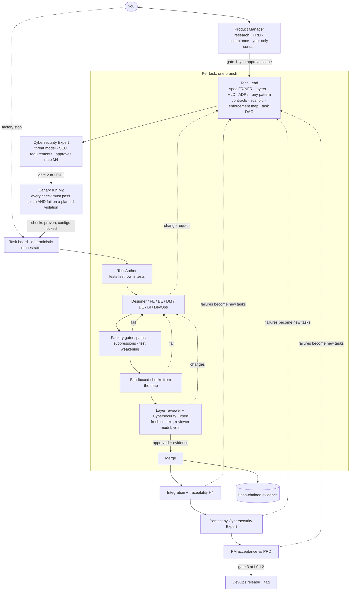

# Software Factory

An autonomous multi-agent software team. You talk to one agent, the **Product Manager**; a team of specialist agents designs, builds, tests, reviews, security-tests and releases the product. Every rule is enforced by code, not by asking agents nicely.

## How it works



**Autonomy.** Agents decide everything inside their scope. Cross-boundary decisions (contracts, dependencies, ADRs, test changes, review disputes) go to the Tech Lead as change requests, and the Tech Lead's decision is final. Ambiguity is resolved by logged assumptions, never by waiting.

**Technology-agnostic.** No stack is assumed. The Tech Lead picks languages, frameworks, patterns (including novel ones) and tools, and proves in `docs/enforcement-map.json` how each rule is enforced in that stack.

## Rules

[rules/rules.json](rules/rules.json) is the rulebook and the single source of truth. Each rule says who enforces it:

| enforced_by | meaning |
|---|---|
| `factory` | the orchestrator itself (board, gates, sandbox, evidence) |
| `project` | a check the Tech Lead maps; the factory proves it with a canary violation (M2) |
| `platform` | GitHub settings once pushed; emulated locally by the orchestrator (only it merges) |

Thresholds (coverage, review rounds, retries, budgets...) live only in the rulebook and reach checks as `FACTORY_*` env vars, so no agent can change them. Agents cannot edit `rules/` at all (K1).

## Roles

[agents/](agents/): product-manager, tech-lead, cybersecurity-expert, designer, frontend-dev, backend-dev, data-modeler, data-engineer, bi-developer, devops, test-author, reviewer, plus the shared [_protocol.md](agents/_protocol.md). Front matter sets each role's model class and allowed tools.

## Enforcement mechanisms

| Mechanism | Rules |
|---|---|
| Agents run headless (`claude -p`) with `--permission-mode dontAsk`, a role tool allowlist, no user settings/hooks/MCP | A1, D3, S9 |
| Only shell is `sbx`: a fresh container, no network (except declared install commands), all capabilities dropped, read-only root, CPU/mem/pid limits, pinned image | F1-F5, A6 |
| After every agent run the orchestrator diffs the work and rejects protected paths, out-of-scope files, test edits by non-test roles, suppression comments, weakened tests | A4, B3, C2, C4, C5 |
| Git control files are fingerprinted; a planted hook or config change halts the factory. Git runs with hooks disabled | A1 |
| Task state machine with illegal-transition errors; dependency ordering; security tasks first | B1, B2, S4 |
| Review JSON schema; uncited findings dropped; Security high/critical = veto | D1-D5, S1 |
| Append-only hash-chained evidence (state/ is outside agents' reach); full transcripts kept | H1-H3 |
| Budgets per call/task/run, retry and change-request caps, halted-ratio circuit breaker, kill switch | G1-G4, J1-J3 |

## Usage

Requires Python 3.13+, [uv](https://docs.astral.sh/uv/), Docker, and the Claude Code CLI (logged in).

```sh
uv sync
uv run factory new my-app --autonomy 1   # L0 approve every merge … L3 fully autonomous
uv run factory chat my-app               # talk to the Product Manager; approve the PRD at the end
uv run factory run my-app                # runs until done, a halt, or a human gate
uv run factory approve my-app            # answer a pending gate (architecture / release)
uv run factory status my-app
uv run factory stop my-app               # kill switch (--clear to release)
uv run factory verify my-app             # verify the evidence chain
uv run factory dashboard my-app          # live dashboard on http://127.0.0.1:8765
```

Projects are created in `projects/<name>` (each its own git repo); orchestrator state, evidence and agent transcripts in `state/<name>`. Per-project overrides (models, budgets, timeouts) go in `state/<name>/config.json`.

## Developing the factory

```sh
uv run ruff check . && uv run ruff format --check . && uv run mypy && uv run pytest
```

`tests/test_pipeline.py` drives a complete run with scripted agents, including a cheating developer, a security veto, a fake check caught by its canary, a kill switch and a git-hook escape attempt.

## Known limits

- Tasks run one at a time; per-task git worktrees would allow parallel agents.
- Claude Code auto-allows commands it classifies as read-only (`ls`, `git status`) even in `dontAsk`; writes, interpreters, network and paths outside the project are denied (verified).
- Containers run as the image's default user with all capabilities dropped; add `--user` for images that support it.
- Network allowlisting is per-command, not per-domain; a filtering proxy would tighten F3.
- The evidence hash chain detects edits and deletions but not a full rewrite; anchor the head hash externally for that.
- Production deploy, canary rollout and auto-rollback (I1-I4 beyond integration) are not wired; release ends at a tagged, documented commit.
- `platform` rules need GitHub branch protection and CODEOWNERS on each pushed project repo.
